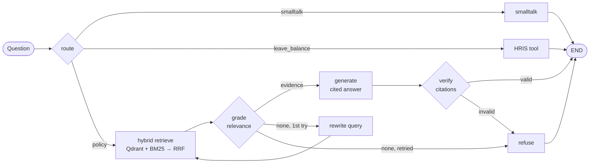

# RAG HR Assistant


A retrieval-augmented HR policy assistant built with **LangGraph**, **FastAPI** and **Qdrant**. It answers employee questions from policy documents with section-level citations, refuses when the answer isn't in the policies, calls an HR system tool for personal lookups, and ships with an **evaluation suite that gates every pull request in CI**.

> The policies in `data/` are for a fictional company. The project is a reference implementation of patterns I use for production RAG systems.

## Results

Evaluated on 30 hand-labelled cases (policy questions, colloquial phrasing, tool calls, out-of-scope and prompt-injection attempts), in offline mode:

| Metric | Score | CI threshold |
|---|---|---|
| Route accuracy | **100%** | 95% |
| Retrieval hit@4 | **100%** | 85% |
| Answer correctness | **96%** | 75% |
| Citation accuracy | **100%** | — |
| Refusal precision / recall | **100% / 100%** | 90% / 100% |
| Latency p95 (offline) | ~5 ms | — |

With `HRA_PROVIDER=openai`, the suite also reports **faithfulness** scored by an LLM judge.

## Architecture



| Path | What happens |
|---|---|
| `app/graph.py` | LangGraph state machine: routing, retrieval, grading, rewrite loop, generation, citation verification |
| `app/retrieval/` | Heading-aware chunking, embeddings, hybrid retriever with Reciprocal Rank Fusion |
| `app/llm.py` | Narrow LLM operations (route, grade, rewrite, generate) behind one interface |
| `app/tools.py` | Mock HRIS lookup for personal leave balances |
| `app/main.py` | FastAPI service: `/chat`, `/ingest`, `/health` |
| `evals/` | Labelled dataset, metrics, CI gate |

## Design decisions

**Hybrid retrieval instead of vectors alone.** Employees mix paraphrase ("time off when my baby is born") with exact terms ("POSH", "INR 1,500"). Dense search handles paraphrase, BM25 handles exact terms, and Reciprocal Rank Fusion combines the two rankings without calibrating their scores against each other.

**Grade before generating.** Retrieved chunks pass a relevance check before the model sees them. Loosely related context is a major source of confident wrong answers, so it's cheaper to filter it out than to fix it afterwards.

**Bounded self-correction.** If nothing relevant is found, the graph rewrites the query into policy vocabulary and retries once. One retry recovers colloquial questions ("vacation", "wfh") while keeping latency and cost predictable.

**Citations are enforced, not requested.** The `verify` node removes citation numbers that don't point at real evidence and replaces an uncited answer with a refusal. For HR, "I don't know, contact HR" is a correct answer; a confident wrong one is a compliance problem.

**Tools for personal data, retrieval for policy.** "How much leave do I have left?" goes to the HR system, not the vector store. Personal data is never embedded or indexed, and a real deployment would call the HRIS with the caller's own token.

**Evals as a CI gate.** Prompt, chunking and model changes regularly fix one case and break three others. Every PR runs the eval suite and fails if any metric drops below its threshold.

**Runs with no API key.** An offline provider (hashing embeddings, rule-based routing and extractive answers) makes tests and CI deterministic and free. Switching to a real model is one environment variable, and any OpenAI-compatible endpoint works, including Azure OpenAI, vLLM and Ollama.

## Quickstart

```bash
git clone https://github.com/Tarak-Ram/rag-hr-assistant && cd rag-hr-assistant
make install
make run        # API on http://localhost:8000, docs at /docs
make test       # unit tests
make eval       # eval suite with thresholds
```

With Docker (API + Qdrant):

```bash
cp .env.example .env    # set HRA_PROVIDER=openai and an API key to use a real model
make up
```

Example request:

```bash
curl -s localhost:8000/chat -H 'content-type: application/json' \
  -d '{"question": "How much is the internet reimbursement for wfh?", "debug": true}'
```

```json
{
  "answer": "Remote-eligible employees receive a one-time home office allowance of INR 15,000 and a monthly internet reimbursement of up to INR 1,500. [1]",
  "citations": ["Remote Work Policy § Equipment and Allowance"],
  "refused": false,
  "route": "policy",
  "latency_ms": 3.1,
  "trace": [{"step": "route"}, {"step": "retrieve"}, {"step": "grade"}, {"step": "generate"}, {"step": "verify"}]
}
```

## Known limitations

- In offline mode the generator is extractive, so it picks matching sentences rather than reasoning over them. The one failing eval case ("Can I go on vacation next week?") retrieves the right section but returns the carry-forward rule instead of the 14-day notice rule. A real LLM resolves this.
- Single-turn only; conversation memory is on the roadmap.
- The HRIS tool is a mock with fixture data.

## Roadmap

- [ ] Cross-encoder reranking and a before/after comparison in the eval report
- [ ] Langfuse tracing with per-node latency and token cost
- [ ] Multi-turn memory with LangGraph checkpointing
- [ ] Human-in-the-loop review queue for low-confidence answers
- [ ] Access control: filter retrieval by employee location and grade
